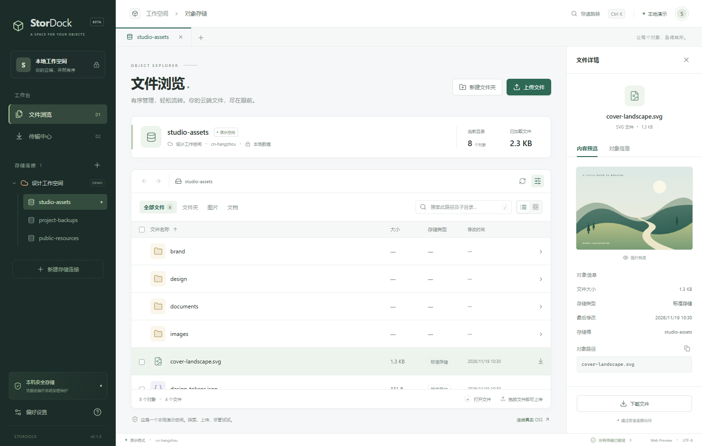

# StorDock

一个简洁、专注的跨平台对象存储客户端。首版支持 **阿里云 OSS**，采用 Electron + React + TypeScript，连接管理和文件操作使用官方 `ali-oss` SDK。

界面参考 [DBX](https://github.com/t8y2/dbx) 的连接树、多标签与工作区组织，代码独立实现。内置本地演示空间，首次启动不需要云端凭据。



## 启动

需要 Node.js **22.12+**（建议 24 LTS）与 npm。

```bash
npm install
npm run desktop
```

首次启动会下载 Electron 运行时。桌面端可创建真实 OSS 连接，无须为 Bucket 配置浏览器 CORS。

仅预览界面与本地演示功能：

```bash
npm run dev
```

打开 http://127.0.0.1:5173 。浏览器演示不连接真实 OSS，不会保存云端凭据。演示上传的文件保存在浏览器本地存储，单文件上限 2 MB，总数据约 8 MB；桌面真实 OSS 连接没有这些演示限制。

## 已实现

- **连接管理**：新建、测试、保存、移除；Region、自定义 HTTPS Endpoint、可选 Bucket、STS 临时凭据；支持仅本次会话保留凭据。
- **存储浏览**：存储桶树、目录导航、面包屑、前进后退、多标签、列表与网格、文件类型筛选、名称／大小／修改时间排序、分页加载。
- **搜索**：在当前路径及其子目录内，按对象路径进行不区分大小写的包含搜索。每次扫描最多 1,000 个对象，未找到结果时也保留继续扫描入口。OSS 没有原生的任意名称包含搜索，因此扫描会产生正常请求费用；排序仅作用于已加载对象。
- **预览**：图片（PNG / JPEG / GIF / WebP / SVG / AVIF / BMP，10 MB 以内）；UTF-8 文本、JSON、Markdown、CSV、代码等（1 MB 以内）；对象路径、大小、修改时间、存储类型和 ETag。不执行 HTML 或 SVG 脚本，其他格式提示下载查看。
- **上传**：多文件选择、拖放、超过 1 MB 使用分片上传、进度和逐文件失败反馈。同名文件通过 OSS `x-oss-forbid-overwrite` 拒绝覆盖。
- **下载**：单文件原生另存为、多文件选择目标目录、流式写入、进度；临时文件在成功后提交，失败后清理；批量下载重名自动加序号。
- **工作空间**：新建文件夹、批量选择、独立传输中心、浅色／深色主题、紧凑列表、快捷跳转和中文界面。

快捷键：`Ctrl / Cmd + K` 跳转存储桶，`/` 聚焦搜索，`Esc` 取消选择或关闭弹窗。

## 连接阿里云 OSS

1. 点击「新建存储连接」，填写名称、Region（例如 `cn-hangzhou`）、AccessKey ID 和 Secret。
2. 可指定 Bucket，适合仅有单桶权限的 RAM 子账号；留空则列出账号可访问的所有桶。跨地域的桶会使用其实际地域发起请求。
3. 使用 STS 时，在高级配置中填写 Token。临时凭据过期后需要移除并重新创建连接；首版未接入自动 STS 刷新。
4. 点击「测试连接」，成功后「保存并连接」。

推荐使用 RAM 子账号。指定桶后，浏览需要 `oss:ListObjects`；预览和下载需要 `oss:GetObject`；上传和创建目录需要 `oss:PutObject`。不指定桶时，列桶还需要 `oss:ListBuckets`。分片上传请按阿里云策略授权对应的 Multipart 操作。

凭据位于 Electron `app.getPath('userData')/connections.json`。Secret 与 STS Token 由 Electron `safeStorage` 的异步系统加密接口保护，解密值不会返回渲染进程。Linux 无可用安全存储时拒绝记住凭据，可取消勾选后仅在内存中使用。Windows 的保护范围为当前系统用户，不能阻止同一用户下的其他程序访问；连接配置不应作为跨设备凭据导出。

系统加密行为见 [Electron safeStorage 文档](https://www.electronjs.org/docs/latest/api/safe-storage/)。OSS 签名启用 V4，接口实现参考 [官方 SDK](https://github.com/ali-sdk/ali-oss)。

## 架构

```text
src/
  App.tsx                  工作区状态、导航和用户操作
  components/              连接表单、预览、弹窗、传输中心
  lib/storage.ts           统一存储桥接，区分演示与桌面
  lib/demo.ts              可写入的本地演示数据适配器
  types.ts                 UI 与平台层的存储契约

electron/
  main.cjs                 窗口、受限 IPC、原生文件对话框
  preload.cjs              白名单 contextBridge API
  oss.cjs                  阿里云存储提供方、流式与分片传输
  vault.cjs                系统加密与连接持久化
  core.cjs                 参数验证、路径约束与列表映射
```

UI 不依赖 Node.js，也不直接读取密钥。主进程只接受可信主框架的白名单 IPC；开启上下文隔离与沙箱、禁用 Node 集成与任意导航；生产资源通过受约束的 `ossdesk://app` 协议加载。新增 S3 等提供方时，可实现现有存储契约与主进程 provider，复用工作区。

## 验证

```bash
npm run build          # TypeScript 与生产前端构建
npm test               # 核心逻辑与传输单元测试
npm run test:e2e       # Chrome 中验证完整演示交互与截图
npm run test:desktop   # 隐藏 Electron 窗口中验证桌面完整流程
npm run test:package   # npm run pack 后验证 Windows 运行目录
```

E2E 默认使用系统 Chrome。Linux CI 需要先安装 Chrome（或按需修改 Playwright 配置）。桌面测试使用隔离的临时目录与模拟 OSS 网络边界；**系统加密、IPC、文件对话框桥接、文件读写、连接重启恢复均走实际桌面实现**。测试不使用真实阿里云凭据，不代表已通过真实云端联调。接入实际账号后仍应进行连接、上传和下载验收。

## 跨平台构建

```bash
npm run pack          # 构建本机平台可运行目录，输出到 release/
npm run dist          # 构建本机平台分发包
```

Windows：NSIS 安装程序与 portable；macOS：DMG / ZIP；Linux：AppImage / DEB。应在对应系统构建和验收；macOS 签名、公证及 Windows 代码签名需要发布者配置证书。仓库提供三平台 CI 配置，当前本地环境仅验证 Windows。

首版不包含断点续传、取消／自动重试、自动更新、对象删除、移动与重命名、PDF／音视频内嵌预览，以及连接编辑／导入导出。运行中的传输记录仅保留本次会话最近 200 项。
