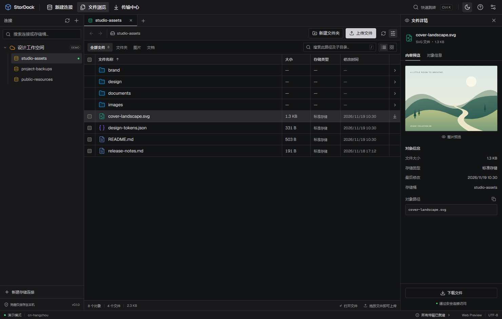
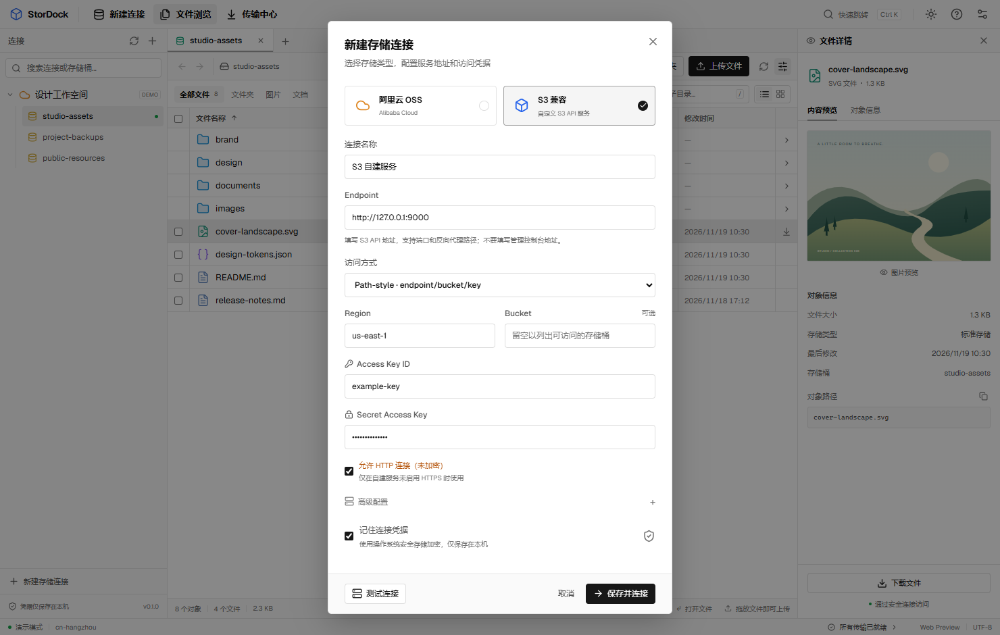

# StorDock

一个简洁、专注的跨平台对象存储客户端。支持 **阿里云 OSS** 与 **自定义 S3 兼容服务**，采用 Electron + React + TypeScript。阿里云使用官方 `ali-oss` SDK，S3 使用 AWS SDK v3，凭据与请求均在桌面主进程中处理。

界面按 [DBX](https://github.com/t8y2/dbx) 的桌面工作区风格实现：黑白灰浅色／深色主题、Geist 字体、紧凑工具栏、连接树、多标签与铺满工作区的文件表格。桌面标题栏集成原生窗口按钮并同步主题，代码独立实现。内置本地演示空间，首次启动不需要云端凭据。




## 启动

需要 Node.js **22.12+**（建议 24 LTS）与 npm。

```bash
npm install
npm run desktop
```

首次启动会下载 Electron 运行时。桌面端可创建真实存储连接，无须为 Bucket 配置浏览器 CORS。

仅预览界面与本地演示功能：

```bash
npm run dev
```

打开 http://127.0.0.1:5173 。浏览器演示不连接真实存储服务，不会保存云端凭据。演示上传的文件保存在浏览器本地存储，单文件上限 2 MB，总数据约 8 MB；桌面真实存储连接没有这些演示限制。

## 已实现

- **连接管理**：新建、测试、编辑、保存、移除；编辑时密钥留空可保留原凭据，Token 可替换或显式清除，密钥不回传界面。支持阿里云 OSS 和 S3 兼容类型。S3 可配置 Endpoint、端口／代理路径、Region、可选 Bucket、Path-style／虚拟主机访问、Session Token 和 HTTP 显式启用；支持仅本次会话保留凭据。
- **存储浏览**：存储桶树、可编辑路径、折叠面包屑、上一级与前进后退、多标签、列表与网格、文件类型筛选、名称／大小／修改时间排序、分页加载。每个标签保留独立的搜索、筛选、排序、选择和滚动位置。
- **搜索**：默认仅筛选当前已加载列表；选择「搜索子目录」后，输入关键词并按 Enter，才会在当前路径及子目录内按对象路径进行不区分大小写的包含搜索。每次扫描最多 1,000 个对象，未找到结果时也保留继续扫描入口。OSS 没有原生的任意名称包含搜索，因此子目录扫描会产生正常请求费用；排序仅作用于已加载对象。
- **预览**：图片（PNG / JPEG / GIF / WebP / SVG / AVIF / BMP，10 MB 以内）；UTF-8 文本、JSON、Markdown、CSV、代码等（1 MB 以内）；对象路径、大小、修改时间、存储类型和 ETag。不执行 HTML 或 SVG 脚本，其他格式提示下载查看。
- **上传**：多文件、文件夹与拖放上传，保留目录结构，桌面端保留空目录。上传确认框提供同名报错、跳过、自动重命名、明确确认后覆盖四种策略。超过 1 MB 使用分片上传；S3 分片不小于 8 MB，失败或取消后尝试清理未完成分片。一次最多 100,000 项，上传目录中的符号链接会被拒绝。
- **下载**：单文件原生另存为、多文件／文件夹选择目标目录，递归下载保留层级和空目录。流式写入，临时文件在成功后提交，失败或取消后清理；批量下载重名自动加序号，拒绝目录中的符号链接与路径越界。浏览器演示按文件触发下载，不提供本地目录写入。
- **对象操作**：当前 Bucket 内批量复制、移动、重命名和删除，文件夹递归展开后先确认对象数和大小，删除需输入「删除」。移动／重命名先完成所有复制，再逐项删除源对象；复制冲突不覆盖，复制阶段失败时保留所有源对象。操作不是原子事务；中途取消或删除阶段失败会保留部分结果，任务中心可重试未完成部分。确认后的新增对象不在删除范围内，单次最多处理 100,000 个对象。
- **任务管理**：上传、下载和对象操作支持取消，失败／取消后可在本次会话内手动重试；重试保留原任务，不会重新弹出文件选择框。取消过程中显示「取消中」，已经提交成功的操作仍显示完成。清除记录仅影响已结束任务。
- **工作空间**：新建文件夹、右键菜单、Ctrl / Cmd 加选与 Shift 连选、筛选后已加载项目全选、多选摘要、详情栏开关记忆。传输中心支持状态筛选，上传完成显示成功／失败数量，底栏展示运行进度与失败数量。支持浅色／深色主题、紧凑列表、快捷跳转和中文界面。

文件与文件夹统一为单击选中、双击打开。详情栏展开时随单选更新；关闭后，单击文件不会重新打开详情栏。文件与文件夹可混合选择后下载，右键或「更多文件操作」进入复制、移动、重命名和删除。

快捷键：`Ctrl / Cmd + K` 跳转存储桶，`/` 聚焦搜索，`Ctrl / Cmd + L` 编辑路径，`Alt + ↑ / ← / →` 上一级／后退／前进。在文件列表中使用方向键选择、`Ctrl / Cmd + A` 全选筛选后已加载项目、`Enter` 打开、`Space` 切换详情栏、`Shift + F10` 打开右键菜单。`Esc` 取消选择或关闭弹窗；输入框保留正常文本编辑行为。

在文件列表中，`F2` 打开重命名，`Delete` 打开删除范围确认，不会直接删除对象。

## 连接阿里云 OSS

1. 点击「新建存储连接」，填写名称、Region（例如 `cn-hangzhou`）、AccessKey ID 和 Secret。
2. 可指定 Bucket，适合仅有单桶权限的 RAM 子账号；留空则列出账号可访问的所有桶。跨地域的桶会使用其实际地域发起请求。
3. 使用 STS 时，在高级配置中填写 Token。临时凭据过期后可编辑连接更新 Token；尚未接入自动 STS 刷新。
4. 点击「测试连接」，成功后「保存并连接」。

推荐使用 RAM 子账号。指定桶后，浏览需要 `oss:ListObjects`；预览和下载需要 `oss:GetObject`；上传和创建目录需要 `oss:PutObject`；复制还需要源对象读取权限，删除／移动还需要 `oss:DeleteObject`。不指定桶时，列桶还需要 `oss:ListBuckets`。分片操作请按阿里云策略授权对应的 Multipart 操作。

为避免 OSS 在版本控制已启用或暂停时忽略 `x-oss-forbid-overwrite`，禁止覆盖模式及复制／移动会读取 Bucket 版本状态，需要 `oss:GetBucketVersioning`。版本控制已启用或暂停时，这些操作会停止，上传需明确选择覆盖策略后再执行。OSS 删除前检查源 ETag，S3 删除还发送 `If-Match`；OSS 的检查与删除不是原子操作，并发写入场景需结合服务端版本控制管理。相关行为见 [OSS CopyObject](https://www.alibabacloud.com/help/en/oss/developer-reference/copyobject)。

## 连接自定义 S3 服务

1. 点击「新建存储连接」，选择 **S3 兼容**。
2. 填写完整 **S3 API Endpoint**，例如 `https://s3.example.com` 或 `http://127.0.0.1:9000`。支持自定义端口和反向代理路径，请勿填写管理控制台地址。
3. 选择访问方式：自建服务优先使用 **Path-style**（`endpoint/bucket/key`）；虚拟主机方式（`bucket.endpoint/key`）需要对应的 DNS 和证书支持。
4. 按服务要求填写 Region，默认 `us-east-1`。Cloudflare R2 使用 `auto`；端点与地域以服务商文档为准。
5. 填写 Access Key ID、Secret Access Key。使用临时凭据时，在高级配置中填写 Session Token；Token 会与密钥一起加密保存。
6. Bucket 可留空以列出可访问的桶；指定 Bucket 时只测试与访问该桶，不要求列出全部桶的权限。支持包含点号的 S3 桶名。
7. HTTP 端点必须显式勾选「允许 HTTP 连接（未加密）」，不会自动关闭 TLS 证书校验。测试成功后保存连接。

协议层支持 ListBuckets、ListObjectsV2、HeadObject、GetObject、PutObject 和分片上传。预览、搜索、目录、传输中心等功能与阿里云连接共用。搜索按页扫描，不是对象内容全文搜索。

默认上传保留“同名不覆盖”行为：S3 服务需要支持 PutObject / CompleteMultipartUpload 的 `If-None-Match` 条件写入；复制使用 CopyObject / CompleteMultipartUpload 的目标条件写入，移动／删除使用 DeleteObject 的 `If-Match`。服务明确拒绝条件时会报告失败，不会自动降级为覆盖或无条件删除。分片还需要 CreateMultipartUpload、UploadPart／UploadPartCopy、CompleteMultipartUpload 与 AbortMultipartUpload 权限。S3 兼容实现存在差异，实际服务仍需按其支持范围验收。

配置参考：[AWS 条件写入](https://docs.aws.amazon.com/AmazonS3/latest/userguide/conditional-writes.html)、[Cloudflare R2 S3 API](https://developers.cloudflare.com/r2/api/s3/api/)。



凭据位于 Electron `app.getPath('userData')/connections.json`。Secret 与 STS / Session Token 由 Electron `safeStorage` 的异步系统加密接口保护，解密值不会返回渲染进程。Linux 无可用安全存储时拒绝记住凭据，可取消勾选后仅在内存中使用。Windows 的保护范围为当前系统用户，不能阻止同一用户下的其他程序访问；连接配置不应作为跨设备凭据导出。

系统加密行为见 [Electron safeStorage 文档](https://www.electronjs.org/docs/latest/api/safe-storage/)。OSS 签名启用 V4，接口实现参考 [官方 SDK](https://github.com/ali-sdk/ali-oss)。

## 架构

```text
src/
  App.tsx                  工作区状态、导航和用户操作
  components/              连接表单、预览、弹窗、传输中心
  lib/storage.ts           统一存储桥接，区分演示与桌面
  lib/demo.ts              可写入的本地演示数据适配器
  types.ts                 UI 与平台层的存储契约

electron/
  main.cjs                 窗口、受限 IPC、原生文件对话框
  preload.cjs              白名单 contextBridge API
  providers.cjs            根据连接类型分发存储请求
  connection.cjs           各类连接参数与 Endpoint 验证
  oss.cjs                  阿里云提供方与共享预览、流式传输
  s3.cjs                   AWS SDK 协议适配与 S3 分片上传
  vault.cjs                系统加密与连接持久化
  core.cjs                 参数验证、路径约束与列表映射
```

UI 不依赖 Node.js，也不直接读取密钥。主进程只接受可信主框架的白名单 IPC；开启上下文隔离与沙箱、禁用 Node 集成与任意导航；生产资源通过受约束的 `ossdesk://app` 协议加载。后续新增其他存储提供方时，可实现现有存储契约与主进程 provider，复用工作区。

## 验证

```bash
npm run build          # TypeScript 与生产前端构建
npm test               # 核心逻辑与传输单元测试
npm run test:e2e       # Chrome 中验证完整演示交互与截图
npm run test:desktop   # 隐藏 Electron 窗口中验证桌面完整流程
npm run test:package   # npm run pack 后验证 Windows 运行目录
```

E2E 默认使用系统 Chrome。Linux CI 需要先安装 Chrome（或按需修改 Playwright 配置）。S3 协议测试通过真实 AWS SDK 与本地 HTTP 测试服务验证签名头、分页、范围读取、上传下载、同名保护和分片清理。桌面测试使用隔离的临时目录，阿里云请求采用模拟边界，S3 请求实际经过本地 HTTP 测试服务；**系统加密、IPC、文件对话框桥接、文件读写、连接重启恢复均走实际桌面实现**。测试不使用真实云端凭据，不代表已通过特定云厂商或 MinIO / Ceph 等部署的现场联调。接入实际账号后仍应进行连接、上传和下载验收。

## 跨平台构建

```bash
npm run pack          # 构建本机平台可运行目录，输出到 release/
npm run dist          # 构建本机平台分发包
```

Windows：NSIS 安装程序与 portable；macOS：DMG / ZIP；Linux：AppImage / DEB。应在对应系统构建和验收；macOS 签名、公证及 Windows 代码签名需要发布者配置证书。仓库提供三平台 CI 配置，当前本地环境仅验证 Windows。

当前不包含跨连接／跨 Bucket 的复制移动、跨会话断点续传、自动重试、自动更新、PDF／音视频内嵌预览及连接导入导出。已结束任务最多保留本次会话最近 200 项，重启后任务记录和重试上下文不保留。
